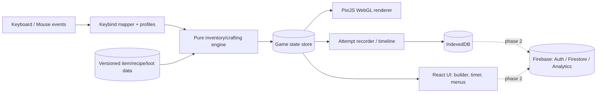

# PRD: Minecraft Crafting Practice Trainer ("CraftPace")

> A browser-based, pixel-accurate Minecraft inventory & crafting simulator for speedrunners to drill crafting routes (buried-treasure loot, iron tools, boat + bucket + doors) with full hotkey support, input remapping, custom challenges, leaderboards, and history.

| Field | Value |
| --- | --- |
| Document status | Draft v1.0 |
| Last updated | 2026-06-29 |
| Owner | (you) |
| Target MC parity | Java Edition, **1.16.1 first**, multi-version architecture |
| Reference gameplay | [MCSR Practice Map](https://github.com/Dibedy/The-MCSR-Practice-Map) modules ("BT Looting & Crafting", "Boat + Door & Iron Tools Crafting"), and the demo video https://www.youtube.com/watch?v=fJkN_Z8m5yg |

---

## 1. Overview & Vision

Minecraft speedrunners (especially Java 1.16.1 RSG/SSG and MCSR Ranked players) spend a large share of every run inside the inventory and crafting GUI: looting a buried-treasure chest, smelting/arranging iron, and crafting tools, a boat, a bucket, and doors as fast as humanly possible. Today they practice this almost exclusively inside Minecraft itself using community practice maps and datapacks (MCSR Practice Map, OWPractice, BTPractice, MiniPracticeKit).

**CraftPace** brings that drilling to the browser: instant load, no Minecraft launcher, no world setup, perfectly repeatable scenarios, frame-accurate input handling, and analytics on every attempt. The simulation must feel **indistinguishable from the real game's inventory** — same mouse semantics, same hotkeys, same shift-click ordering, same drag distribution, same recipe behavior — so that muscle memory transfers 1:1 back to Minecraft.

### Why this is needed
- Real-Minecraft practice requires launching the game, loading a map, and resetting state between attempts (slow, lossy).
- There is **no dedicated web tool** that faithfully reproduces MC inventory mechanics with timing + leaderboards.
- A web tool unlocks features the game can't easily offer: per-attempt analytics, click heatmaps, global leaderboards, instant scenario remapping, and shareable custom challenges.

---

## 2. Goals & Non-Goals

### 2.1 Goals
- G1. **Pixel-and-behavior-accurate** inventory + crafting simulation matching Java Edition exactly (mouse, keyboard, drag, shift-click ordering, stack splitting, recipe book).
- G2. **Zero perceptible input lag** — input-to-render under one frame at a locked 60 FPS (ideally support 120/144 Hz displays).
- G3. **Full keybind coverage** of every inventory-relevant Minecraft control, with complete **input remapping**.
- G4. Ship the canonical speedrun scenarios first: **BT loot → iron tools**, and **boat + bucket + doors**.
- G5. **Custom challenge builder** + **starting setups** with a large library of Minecraft blocks/items so users craft and share their own drills.
- G6. **Faithful-style open/CC-licensed textures** for all blocks/items (legally safe for a public site).
- G7. Per-attempt **timing, splits, and scoring** designed for speedrun analysis.
- G8. **Firebase phase (later):** auth, cloud-saved settings, global/category leaderboards, attempt history, and analytics.

### 2.2 Non-Goals (v1)
- N1. 3D world movement, walking, mining, mob combat, or rendering the overworld. (Inventory/crafting GUI only.)
- N2. Bedrock Edition parity, console/touch controllers (keyboard+mouse first; touch is a stretch goal).
- N3. Multiplayer/real-time co-op crafting races (future consideration).
- N4. Distributing official Mojang textures.
- N5. Smelting *fuel realism* beyond what's needed for crafting drills (configurable, see F-Furnace).

---

## 3. Target Users & Personas

- **Persona A — Ranked grinder ("Iz"):** Plays MCSR Ranked daily, wants warmup drills and to shave tenths off BT-craft. Cares about leaderboards, splits, and exact parity.
- **Persona B — Aspiring speedrunner ("Sam"):** Learning crafting routes, needs guided scenarios, recipe hints, and a recipe book. Cares about onboarding and "show me the optimal route."
- **Persona C — Content creator ("Theo"):** Builds and shares custom challenges (e.g., "Save the Cat"-style timed crafts), wants shareable links and embeddable leaderboards.

---

## 4. Success Metrics
- **Parity:** ≥ 95% of test-suite inventory interactions produce identical end-state to Minecraft 1.16.1 (validated against documented mechanics + recorded clips).
- **Performance:** p99 input-to-paint latency ≤ 16.6 ms; sustained 60 FPS with a full 36-slot inventory + 3×3 grid + dragging.
- **Engagement (post-Firebase):** median ≥ 10 attempts/session for returning users; D7 retention target ≥ 25%.
- **Creation:** ≥ 1 custom challenge created per 5 active users; shared-challenge open rate tracked.

---

## 5. Reference Gameplay (what we're modeling)

From the MCSR Practice Map's "Overworld Practice" the relevant modules are:
- **Ruined Portal + Buried Treasure** and **BT Looting & Crafting** — open a buried-treasure chest, grab loot, smelt/arrange iron, craft tools.
- **Boat + Door & Iron Tools Crafting** — craft a boat, doors, bucket, and iron tools quickly.
- **Inventory Sorting, Clean-Up** — reorganize an inventory under time pressure.
- **Search Crafting** and **Queue Games** (e.g., "Save the Cat — craft faster than the lava flows", "Replica — rebuild shown builds fast") as inspiration for custom challenge templates.

### 5.1 Canonical scenario recipes to model first (Java 1.16.1)
| Item | Recipe (shaped unless noted) | Notes |
| --- | --- | --- |
| Oak Planks | 1 log → 4 planks (shapeless) | Any wood type; per-version wood set. |
| Stick | 2 planks (vertical) → 4 sticks | |
| Crafting Table | 2×2 planks → 1 | |
| Furnace | 8 cobblestone (ring) → 1 | For smelting raw iron/gold. |
| Iron Pickaxe | 3 iron (top row) + 2 sticks (center column) | |
| Iron Sword | 2 iron (column) + 1 stick | |
| Iron Shovel | 1 iron + 2 sticks (column) | |
| Iron Axe | 3 iron + 2 sticks | |
| Bucket | 3 iron in "V" (slots 1,3,5) | Water/lava MLG + portal. |
| Flint & Steel | 1 iron + 1 flint (diagonal) | |
| Oak Boat | 5 planks "U" (slots 1,3,4,5,6) | Shipwreck travel. |
| Oak Door | 6 planks (left 2 columns) → 3 doors | |
| Shears | 2 iron (diagonal) | Optional. |

> Loot tables: a buried-treasure chest preset will pre-fill loot (Heart of the Sea, iron ingots, gold, TNT, cooked cod, emeralds, leather/diamond on rare presets) so users practice the *grab + craft* sequence, not RNG. Loot presets are versioned data.

---

## 6. Core Concepts & Glossary
- **Slot:** a single inventory cell (hotbar 0–8, main inventory 9–35, armor, off-hand, crafting grid, output, container slots).
- **Cursor stack:** the item stack currently held on the mouse cursor.
- **Container:** any open GUI besides the player inventory (crafting table, furnace, chest, chest-boat).
- **Scenario / Challenge:** a defined starting state + goal + scoring rule.
- **Setup / Starting setup:** a saved initial inventory + open-container configuration.
- **Split:** an intermediate timed checkpoint within a challenge (e.g., "boat done", "bucket done").
- **Attempt:** one run of a challenge, recorded with inputs, timing, and result.

---

## 7. Functional Requirements

### F1 — Inventory & Crafting Simulation Engine (THE core; must be exact)
A deterministic, version-parameterized state machine that reproduces Java Edition inventory semantics precisely. Required behaviors:

**Mouse semantics**
- **Left-click** empty slot with cursor stack → place full stack; on identical stack → merge up to max; on different stack → swap.
- **Left-click** a slot (empty cursor) → pick up full stack.
- **Right-click** empty cursor on a stack → pick up half (odd leaves smaller half behind; stack of 7 → grab 4, leave 3).
- **Right-click** holding a stack → place one item; repeat per click.
- **Double-click** with cursor stack → gather up to a full stack of identical items from the inventory into the cursor.
- **Left-drag** across slots → distribute the cursor stack evenly among dragged slots (remainder stays on cursor); only into empty/identical slots.
- **Right-drag** across slots → place exactly one per dragged slot.
- **Middle-click / middle-drag** (creative/sandbox mode) → grab/clone a full stack; place a full stack per dragged slot. Disabled if "pick block" is rebound (match the documented quirk).

**Keyboard semantics (while a GUI is open)**
- **1–9** → swap the hovered slot with the corresponding hotbar slot (`key.hotbar.1`–`9`).
- **Q** → drop one item from hovered slot; **Ctrl+Q** → drop the entire hovered stack (Ctrl not rebindable, matching MC).
- **F** → swap hovered slot with off-hand.
- **Shift+click** → quick-transfer with **exact MC ordering**:
  - Hotbar ↔ main inventory: left→right, top→bottom.
  - With external container open: inventory→container (top-left→bottom-right) or container→inventory (bottom→top, right→left starting hotbar slot 9).
  - Armor pieces auto-route to armor slots.
- **Shift+double-click** → move all identical items between inventory and container (or collect-all into top-left-most slot if only the player inventory is open).
- **Shift+click crafting output** → craft the **maximum** amount possible and move directly to inventory (1.16 behavior).
- Click **outside** the window while holding a stack → drop it into the "world" (sink).

**Crafting**
- 2×2 grid from player inventory; 3×3 from crafting table.
- Shaped and shapeless recipe matching (position-aware, mirrorable per recipe), tag-based ingredients (e.g., "any planks", "any log").
- Crafting output behaves like MC: take one craft per left-click of output, max-craft on shift-click, decrement ingredients correctly, return leftovers (e.g., empty buckets for milk-style recipes — not needed v1 but engine should support container-item remainders).
- Recipe book panel (unlocked recipes, "fill recipe" click, version-accurate).

**Furnace (smelting)**
- Input + fuel + output slots; smelt raw iron/gold → ingots; configurable instant-smelt toggle for drills, or realistic smelt timing for "full route" mode.

**Determinism & correctness**
- Engine is pure (state + event → new state), framework-agnostic, fully unit-tested against a behavior matrix derived from the Minecraft Wiki ([Inventory](https://minecraft.wiki/w/Inventory), [Crafting](https://minecraft.wiki/w/Crafting), [Controls](https://minecraft.wiki/w/Controls)).
- All randomness (loot) seedable for reproducible practice.

### F2 — Recipe & Item Data System (data-driven, versioned)
- Items, blocks, recipes, stack sizes, smelting maps, and loot tables stored as **versioned JSON data** (`/data/1.16.1/`, `/data/1.21/`, ...).
- Schema mirrors Minecraft's datapack recipe JSON where practical (shaped/shapeless/smelting) to ease authoring and future versions.
- A version selector swaps the active dataset; engine reads behavior flags per version (e.g., shift-craft semantics, recipe differences).
- Tooling/script to import/transform recipe data so we don't hand-author thousands of recipes.

### F3 — Hotkeys & Input Remapping (must be comprehensive)
- Implement **every inventory-relevant default keybind**, mirroring MC's `options.txt` keys:
  - `key.inventory` (E), `key.drop` (Q), `key.hotbar.1`–`9`, `key.swapOffhand` (F), `key.pickItem` (middle mouse), attack/use (left/right mouse), plus utility: open crafting/recipe book, sort, close (Esc).
  - Also expose useful non-GUI keys present in MC controls for completeness (F3 debug overlay analog, screenshot, fullscreen F11, perspective) where they make sense in a web tool, clearly marked as "tool" keys vs "MC parity" keys.
- **Full remapping UI**: click-to-rebind, conflict detection, modifier support, reset-to-default, multiple **keybind profiles** (e.g., "My MC layout", "Vanilla"). Mirrors MC behavior where some bindings (Shift, Ctrl for drop-stack, LMB/RMB) are **not rebindable**.
- Bindings persist locally (and to Firebase later). Import/export keybinds as JSON; optional "paste your options.txt" importer (stretch).

### F4 — Challenge / Scenario System
- A challenge = `{ startingSetup, goal, scoring, splits, version, seed }`.
- **Built-in challenges (v1):**
  1. **Buried Treasure Loot** — grab all loot from the BT chest into inventory in optimal order.
  2. **Iron Tools Craft** — from raw materials, craft pickaxe/sword/shovel(/axe).
  3. **Boat + Bucket + Doors** — the canonical craft set, scored on total time with per-item splits.
  4. **Inventory Sort / Clean-Up** — reorganize to a target layout.
  5. **Full BT Route** — chained: loot → smelt → craft tools → boat + bucket + doors.
- **Goal types:** "inventory matches target state", "items crafted = set", "container emptied", "layout matches".
- **Scoring:** primary = elapsed time; secondary = click count / actions-per-item efficiency; failure conditions (wrong craft, dropped item) optional per challenge.
- **Splits/timer:** millisecond timer, auto-split on goal sub-conditions, PB tracking, attempt reset hotkey, optional countdown/"ready-go".

### F5 — Custom Challenge Builder
- Visual editor: drag items/blocks into starting inventory + containers, choose open container (crafting table/furnace/chest/none), set goal, define splits, set seed/loot table.
- **Large block/item palette** (searchable, categorized like the creative inventory: building blocks, decoration, redstone, transportation, food, tools, combat, brewing, misc).
- Save locally; **share via URL** (challenge encoded/serialized, later stored in Firebase with a short ID).
- Clone & remix existing challenges.

### F6 — Starting Setups / Inventory Presets
- Preset library: empty, "post-BT inventory", "shipwreck loot", "full iron", and many block-filled creative-style presets.
- Users save their own setups and reuse across challenges.
- One-click apply; presets are version-aware.

### F7 — Assets / Sprites
- Use an **open/CC-licensed Faithful-style texture set** for all items/blocks (no official Mojang textures shipped).
- Render via a **texture atlas / sprite sheet** for performance; nearest-neighbor scaling for crisp pixel-art; correct GUI panels, slot frames, durability bars, stack-count text, enchanted-item shimmer (stretch).
- Asset pipeline: atlas generation script; per-version asset folders; graceful fallback placeholder for missing textures.
- Document texture pack license + attribution in-app and in repo.

### F8 — Timing, Scoring & Replay
- High-resolution timer (`performance.now`), frame-synced.
- Record an **input timeline** per attempt (event + timestamp + slot) enabling: replay playback, click heatmaps, and "ghost" comparison vs PB (stretch).
- Export attempt as JSON.

### F9 — Firebase Integration (Phase 2 — "later")
- **Auth:** Google + email/anonymous; anonymous→account upgrade so guests keep history.
- **Cloud settings:** keybinds, presets, custom challenges synced across devices.
- **Leaderboards:** per-challenge, per-version, per-category (RSG-style); time-based with anti-cheat sanity checks (server-validated min times, input-timeline submission, rate limiting via Firestore rules / Cloud Functions).
- **History:** every attempt stored; personal trends (best/avg/recent, improvement over time).
- **Analytics:** funnels (challenge starts→completions), per-mechanic difficulty, retention, custom events; respect privacy/consent.
- Designed so v1 works **fully offline/local**; Firebase is additive, not a dependency for core practice.

### F10 — Settings & Persistence
- Local-first (IndexedDB/localStorage) for keybinds, presets, custom challenges, attempt history; later mirrored to Firebase.
- Settings: GUI scale (match MC's 1–4 / auto), FPS cap, sound on/off (UI click sounds optional), theme, version selector, instant-smelt toggle, show-recipe-hints toggle.

---

## 8. Non-Functional Requirements
- **Performance (top priority):** locked 60 FPS, sub-frame input latency, no GC stutter during drag. Use an immutable-but-cheap state update path, requestAnimationFrame render loop, and a WebGL/Canvas sprite renderer (avoid per-slot DOM churn). Pre-bake texture atlas; batch draws.
- **Accuracy:** parity test suite gates releases.
- **Cross-platform:** modern Chrome/Firefox/Edge/Safari desktop; keyboard+mouse. Handle OS-level key differences (Cmd vs Ctrl on macOS) explicitly.
- **Accessibility:** colorblind-friendly UI accents, remappable keys (helps a11y), scalable UI, reduced-motion option.
- **Offline:** core trainer works with no network.
- **Privacy:** analytics opt-in/consent; no PII beyond auth basics.

---

## 9. Tech Architecture & Stack

**Chosen for "no lag + well-made + exact MC feel":**
- **App shell / UI:** React + TypeScript + Vite (menus, builder, settings, leaderboards).
- **Game surface:** a dedicated **canvas renderer** — **PixiJS (WebGL)** for the inventory/crafting grid and dragging, so thousands of sprite draws and drag updates stay at 60 FPS without DOM thrash. (Falls back to 2D canvas if WebGL unavailable.)
- **Engine:** a **pure, framework-agnostic TypeScript core** (`/engine`) — no React/Pixi imports — so it is unit-testable and reusable. UI dispatches input events; engine returns new state; renderer paints it.
- **State:** lightweight store (Zustand or a custom event store) bridging engine ↔ React ↔ Pixi.
- **Data:** versioned JSON in `/data/<version>/` (items, recipes, smelting, loot, presets).
- **Persistence:** IndexedDB (local) now; **Firebase (Auth, Firestore, Analytics, optional Cloud Functions for leaderboard validation)** later.
- **Testing:** Vitest for engine parity matrix; Playwright for input/integration; visual regression for renderer (stretch).
- **Tooling:** ESLint/Prettier, asset-atlas build script, recipe-import script.

### High-level data flow


### Suggested repo structure
```
/engine            # pure TS sim (no UI deps) + tests
/data/1.16.1       # items, recipes, smelting, loot, presets
/data/1.21
/assets/<version>  # open-license texture atlases
/src/render        # PixiJS renderer
/src/ui            # React app shell, builder, settings, leaderboards
/src/input         # keybind mapper + profiles + remap UI
/src/challenges    # built-in challenge definitions
/src/firebase      # phase 2 integration (lazy-loaded)
/scripts           # atlas + recipe import tooling
```

---

## 10. Data Models (initial schemas)

```ts
// Item / stack
type ItemId = string;            // "minecraft:iron_ingot"
interface ItemStack { id: ItemId; count: number; durability?: number; }

// Slot model
type SlotKind = "hotbar" | "main" | "armor" | "offhand" | "craftIn" | "craftOut" | "container";
interface Slot { index: number; kind: SlotKind; stack: ItemStack | null; }

// Recipe (mirrors datapack-style)
interface ShapedRecipe { type: "shaped"; pattern: string[]; key: Record<string, ItemId | ItemId[]>; result: ItemStack; }
interface ShapelessRecipe { type: "shapeless"; ingredients: (ItemId | ItemId[])[]; result: ItemStack; }
interface SmeltingRecipe { type: "smelting"; input: ItemId; result: ItemStack; time?: number; }

// Challenge
interface Challenge {
  id: string; name: string; version: string; seed?: number;
  startingSetup: SetupSnapshot;          // inventory + open container
  goal: Goal;                            // matchState | craftSet | emptyContainer | layout
  splits?: SplitDef[]; scoring: ScoringRule; authorId?: string; shared?: boolean;
}

// Attempt (recorded)
interface Attempt {
  id: string; challengeId: string; userId?: string;
  startedAt: number; durationMs: number; completed: boolean;
  splits: { name: string; atMs: number }[];
  inputTimeline: InputEvent[];           // for replay + anti-cheat
  clicks: number; version: string;
}
```

(Firestore collections phase 2: `users`, `challenges`, `attempts`, `leaderboards/{challengeId}` — with security rules validating ownership and basic anti-cheat.)

---

## 11. UI / UX & Screens
- **Home / Practice Hub:** pick a challenge (built-in categories + community), version selector, recent PBs.
- **Practice Screen:** centered MC-style inventory GUI (correct GUI texture, slot grid, hotbar), open-container variants (crafting table 3×3, furnace, chest, chest-boat), timer + splits HUD, recipe-book toggle, reset/retry, "show optimal route" hint toggle.
- **Challenge Builder:** creative-style item palette (searchable, tabbed), drag-to-place, container chooser, goal/splits/seed config, save/share.
- **Keybinds / Settings:** remap UI with conflict detection, profiles, GUI scale, FPS, audio, theme, version, accessibility.
- **Leaderboards (phase 2):** per-challenge/category tables, your rank, filters.
- **Profile / History (phase 2):** trends, PBs, replays.
- Visual fidelity: match MC GUI spacing, slot size, hover highlight, stack-count rendering, tooltips, durability bars.

---

## 12. Versioning Strategy
- Engine reads **per-version behavior flags** + per-version data; default ship **1.16.1** (MCSR standard) with **latest (1.21.x)** as the second target.
- Differences handled in data + flags (recipe set, stack sizes, shift-craft semantics, off-hand availability, new blocks/items for builder palette).
- Leaderboards & challenges are tagged by version (you don't compete across versions).

---

## 13. Milestones / Roadmap

**Phase 0 — Foundations (engine + data)**
- Pure inventory/crafting engine with full mouse/keyboard parity; 1.16.1 item/recipe/loot data; Vitest parity matrix.

**Phase 1 — Playable trainer (local-only, no Firebase)**
- PixiJS renderer + React shell; Faithful-style atlas; crafting table + furnace GUIs; timer/splits; built-in challenges (BT loot, iron tools, boat+bucket+doors, sort); full keybinds + remapping; settings/persistence (local).

**Phase 2 — Creation & sharing**
- Custom challenge builder + large block palette; starting-setup presets; share-via-URL; attempt recorder + replay.

**Phase 3 — Firebase**
- Auth; cloud sync (settings/presets/challenges); leaderboards + anti-cheat validation; history/trends; analytics.

**Phase 4 — Multi-version + polish**
- 1.21.x dataset; version selector; visual polish, sounds, a11y; (stretch) touch support, ghost replays, embeddable leaderboards.

---

## 14. Risks & Mitigations
- **Exact parity is hard** (drag/shift-click edge cases). → Build a documented behavior matrix from the wiki + recorded clips; gate releases on the parity test suite.
- **Performance with many sprites/drag.** → WebGL atlas batching, rAF loop, avoid per-slot DOM.
- **Texture licensing.** → Use only open/CC-licensed Faithful-style assets; document attribution; never ship Mojang textures.
- **Leaderboard cheating.** → Submit input timelines, validate server-side (Cloud Functions), min-time sanity checks, rate limits, anonymous abuse controls.
- **Scope creep (3D/world).** → Hard non-goal for v1; keep to GUI.

---

## 15. Open Questions
- Exact open-license texture pack to standardize on (specific Faithful fork / CC source) — to confirm before asset pipeline.
- Which secondary scenarios beyond the canonical set to ship in v1 (shipwreck loot? village crafts?).
- Sound effects: include UI/click sounds for feel, or keep silent v1?
- Leaderboard categories taxonomy (mirror MCSR Ranked categories?).
